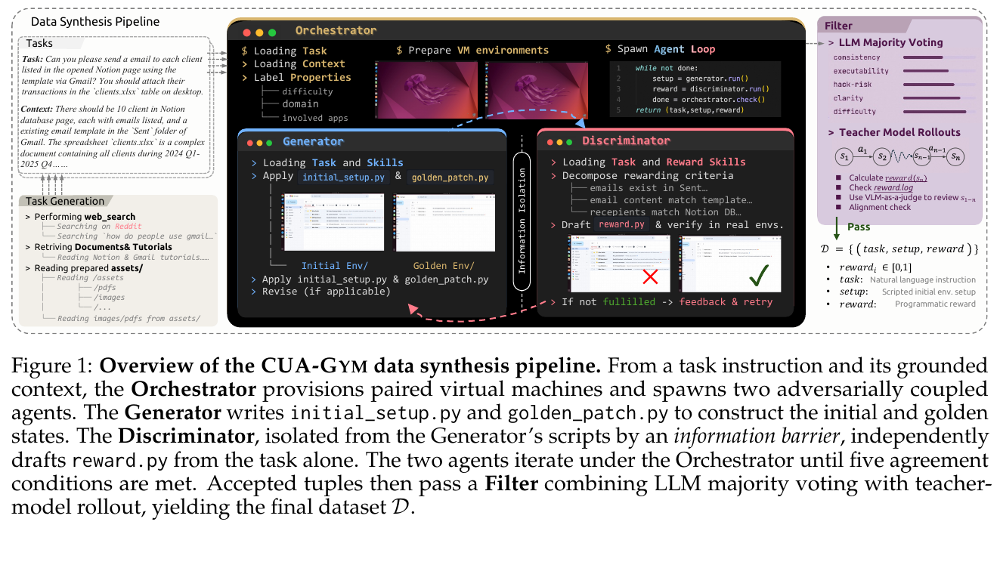
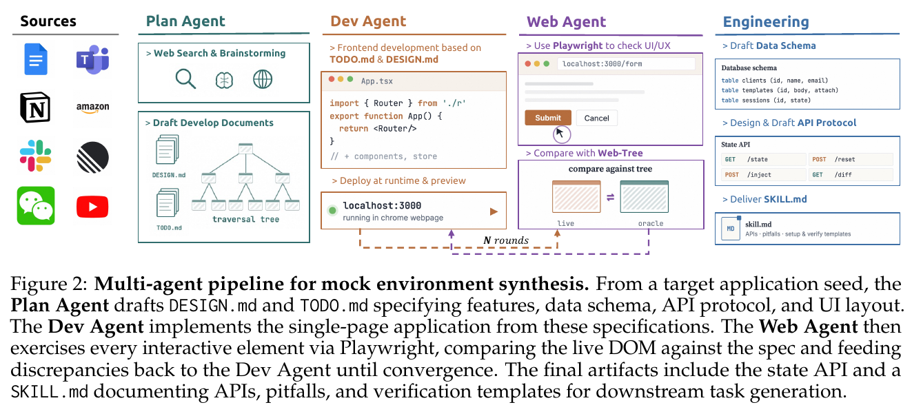
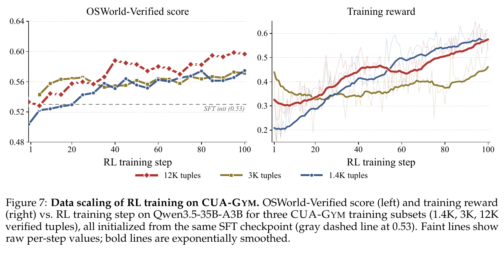
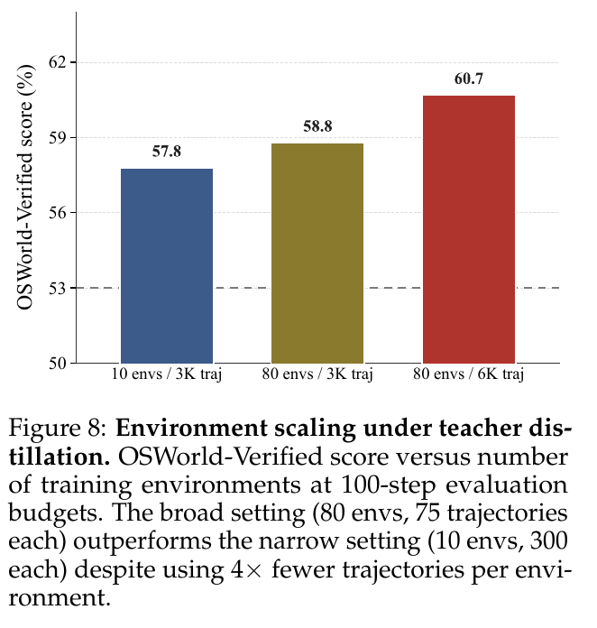

# 一句话理解

CUA-Gym 要解决的是：怎样批量造出一项电脑操作任务所需的**指令、可复现初始环境和可信奖励函数**，使 Agent 能反复尝试、得到程序分数，并通过 RL 学会完成任务？它把这三个相互约束的工程产物放进同一条合成与验证 pipeline，同时生成可注入状态的网页 mock 来扩展环境覆盖。

本文依据 arXiv:2605.25624v2，重点核查正文方法与实验、附录 A/B 的合成机制、附录 E 的任务与迭代示例，以及附录 G 的提示词。以下标为“原文”的内容来自论文，标为“解释”或“判断”的内容是对机制及证据边界的分析；没有复现训练或审计发布代码。

## 1. Motivation：为什么需要解决这个问题

数学任务通常可以给出题目并检查答案，代码任务可以运行测试。电脑操作任务多了一层：首先要有一个可操作的世界。要求“给客户发邮件并附上交易表”，必须预先存在客户名单、地址、模板、交易文件、邮箱状态和可用界面；判分还要检查收件人、正文与附件是否一致。只有一句自然语言指令，无法直接成为 RL 数据。

原文在第 1 节把数据单元写作 `(t, s, r)`：任务指令 `t`、可执行环境状态 `s`、程序化奖励 `r`。三者必须吻合。初始状态已经完成任务会给策略虚假的正奖励；任务要求界面做不到的操作会制造不可解样本；奖励只检查文件名会鼓励创建空文件。数据质量因此是三者的联合质量，而非单独评价题目是否丰富。

另一个瓶颈是应用覆盖。真实网站涉及登录、限流、外部服务和不断变化的状态，难以供成千上万次 rollout 重置。人工维护少数应用可以获得可靠判分，却很难覆盖长尾工作流。CUA-Gym 同时扩大任务数量和可控环境数量。依据：正文第 1、2 节，PDF 第 1–4 页。

## 2. Insight：最值得记住的想法

**把合成任务理解成构造一道可执行的题，而不是扩写问句。** 同一规格要落实为输入世界、预期结果和检查标准。目标环境提供一个正例，初始环境提供一个负例，独立判分 Agent 把需求转为奖励，再通过实际执行验证它们是否一致。

**把“程序稳定”与“程序判得正确”分开。** 固定代码给出可重复的分数，解决的是判分噪声；代码是否覆盖任务语义仍需验证。信息隔离、禁止模式扫描、人工智能审查与 rollout 是不同层次的补救措施，不能相互替代。

**把环境当作可复用的生成底座。** 同一套网页代码，注入不同业务数据，就能产生不同任务；增加新的应用模型则引入新的交互与业务结构。CUA-Gym-Hub 承担这一环境层，CUA-Gym 是在环境层上实例化的任务包集合。依据：正文第 2 节，PDF 第 3–4 页；第 6 节，PDF 第 10 页。

## 3. Method：数据构造 pipeline 如何工作

### 3.1 全流程：从需求来源到可训练任务包



读图要点：左侧产出的是任务规格，中间产出并修正可执行状态与判分脚本，右侧再检查真实 Agent 行为。Generator 与 Discriminator 的隔离边界是生成脚本；两个 VM 的状态仍是后者可观察的验证对象。

```text
使用模式、软件文档、准备好的素材
  -> 功能树 + 场景覆盖矩阵
  -> 指令 t + 初始世界要求 c
  -> Generator 构造初始 VM 与目标 VM
  -> 隔离的 Discriminator 编写 reward.py
  -> 静态扫描 + 五个一致性条件 + 失败反馈迭代
  -> 多模型审查与必要的指令修订
  -> 教师真实操作 + 程序分数/视觉判分对照
  -> 可复现任务包
  -> 成功教师轨迹用于 SFT；策略 rollout 用于 RL
```

这条图解是对正文第 2.1 节和附录 Algorithm 1 的整理，不代表新增实验。

### 3.2 先组织覆盖，再生成指令与上下文

原文先从官方文档和真实使用模式调研构建应用功能树。内部节点归组功能，叶子对应原子 UI 能力，例如 Calc 的“格式 → 单元格外观 → 条件格式”。叶子包含能力描述和涉及的 UI 元素，让生成器知道应覆盖哪个操作，而不是随意编题。

在功能树上再叠加五维矩阵：平台、领域、难度、场景和任务类型。平台区分桌面、网页与跨平台；场景包括商业、教育、科研与个人；任务类型区分单应用和跨应用。采样器记录每个格子的已有数量，使用逆频率权重补足覆盖不足的格子，并给长尾应用设最低覆盖约束。**解释：功能树负责“软件能做什么”，矩阵负责“这些能力在什么情境和复杂度下被使用”。**

生成分为三轮：

- **Breadth：铺开。** 广泛覆盖功能叶子，先形成较完整的能力库存。
- **Gap-fill：补缺口。** 根据第一轮统计补采不足的格子，并提高困难任务、跨应用任务的权重。
- **Edge cases：边界任务。** 结合失败分析覆盖少见的应用组合、拖拽、组合快捷键、多窗口导航和接近可解性边界的任务。

原文还用句向量相似度、4-gram 重合度和单模板实例数限制重复。附录报告的阈值为相似度 ≥0.85、4-gram 重合超过 50%、同应用单模板最多 3 个实例。它们能限制文本重复，但语义上是否真有不同的业务操作，还要靠功能与场景覆盖判断；换名字并不自动成为新能力。

最后产出 `(t, c)`。`t` 是执行者要完成的事；`c` 列出初始世界必须具备的实体、文件和应用状态。Figure 1 的例子中，任务要求从 Notion 客户名单、Gmail 模板和桌面交易表形成邮件；上下文则规定名单和模板已存在、交易表覆盖哪些期间。上下文指导环境构造，不能假定训练策略直接得到与生成器完全相同的全部材料；最终对策略可见的指令是否自洽，需要筛选阶段检查。

依据：正文第 2.1 节，PDF 第 3 页；附录 A.2、G.2，PDF 第 14–16、76–77 页。附录的具体覆盖配额存在矛盾，见结论边界。

### 3.3 Generator：把世界准备好，再构造一个正确完成的世界

Orchestrator 为任务准备两个隔离 VM。Generator 读取任务、上下文和领域技能，编写两个脚本：

- `initial_setup.py`：在初始 VM 建立任务执行前的世界，生成输入文件、注入应用数据，并准备 GUI。
- `golden_patch.py`：在目标 VM 建立正确完成后的世界，供奖励正例校验。

目标 VM 是独立构造的正例，不能把它想成策略必须逐步模仿的操作轨迹。附录案例中，Generator 可以用文件库直接写出目标产物，而执行策略仍需在 GUI 中完成任务。因此**脚本能生成目标文件，不足以证明 UI 路径可达**；这也是后面必须做教师 rollout 的原因。

初始环境还要满足“人或 Agent 打开就能开始工作”：应用启动、文件打开、窗口合适，并移除保存、恢复或安全提示等模态弹窗。只把文件放进磁盘而没有准备 UI，仍可能让题目与观察状态错位。

这里还要区分**独立 VM 构造**与**保留文件属性**。G.3 明确要求 golden 在目标 VM 内独立生成，禁止从初始 VM 加载或复制文件；A.5 的领域技能则要求已有输入文件采用 copy-then-modify，保留元数据、打印设置等隐含属性。不能据此画一条从初始 VM 直接复制文件到目标 VM 的箭头。两项要求若要同时满足，需要在目标 VM 内取得一致的本地基础文件，再复制修改；这是实现要求的解释，论文没有充分交代具体如何同步基础素材。

**解释：初始和目标世界应共享同一业务事实，只改变任务要求完成的部分。** 否则奖励可能识别两个世界的随机差异，或者策略面对的数据与 golden 所依据的数据根本不一致。依据：正文第 2.1 节，PDF 第 3 页；附录 A.5、G.3，PDF 第 19–20、77–78 页。

### 3.4 Discriminator：隔离的是生成过程，奖励检查的是任务结果

正文有“从任务描述独立写奖励”的简写，但具体权限须以正文细节和附录访问矩阵一起理解：Discriminator 可以读取 `(t, c)`、领域技能和两个 VM 的状态视图；不能读取 Generator 的脚本或工作目录，也不能把 VM 产物下载到本地绕开隔离。

| 对象 | Generator | Discriminator |
| --- | --- | --- |
| 指令、上下文、领域技能 | 可读 | 可读 |
| 初始/目标构造脚本与生成工作目录 | 可写、可访问 | 禁止访问 |
| 两个 VM 的结果状态 | 可查看 | 经状态 API 查看 |
| reward.py | 不可访问 | 编写 |
| REVIEW.md | 读取反馈 | 写出判定与反馈 |

这种隔离针对的捷径是：奖励作者直接看生成脚本，再把构造时使用的标志、常量或产物身份当成任务完成证据。隔离后，它仍能看到 golden，以便测试奖励，但应从需求推导收件人、内容、数据值等语义检查，不能只记住 golden 的字节或哈希。

奖励被分解为细粒度条件，并累积为 `[0,1]` 的部分分数。这给未完全完成的 rollout 保留区分度。原文 G.4 特别要求：**只有任务新增的变化才能给分；两端原本都成立的属性是前置条件。** 例如任务是隐藏 Raw Data，Summary 初始就可见，那么“Summary 可见”不能单独得分；可以作为“Raw Data 已隐藏且 Summary 保持可见”的联合条件。数据未损坏也应作为准入门槛，而不是让未执行任务的策略白拿奖励。

**解释：奖励不是盲目给所有 diff 计分。** 非目标字段的变化可能是副作用，任务要求才决定哪些 diff 有价值。合理形式是“必要的完整性约束通过后，为要求的新状态给分”。依据：附录 A.3.2、G.4，PDF 第 16–17、79 页。

### 3.5 内循环：五个条件和定向反馈

| 条件 | 检查什么 | 能排除的问题 |
| --- | --- | --- |
| C1 | initial_setup 执行成功 | 初始世界构造失败 |
| C2 | golden_patch 执行成功 | 目标世界构造失败 |
| C3 | 目标环境奖励 = 1 | 目标产物不满足奖励或奖励实现错误 |
| C4 | 初始环境奖励 = 0 | 原本已完成或给前置状态白送分 |
| C5 | 奖励不含禁止模式 | 常量、空检查等明显判分捷径 |

原文禁止模式包括：未经计算直接把验证标志置 True、占位验证、没有状态检查就返回固定成功分、仅凭文件存在给分、使用 subprocess，以及只有注释没有实际验证。扫描通过正则与 AST 检查完成。C5 的保证范围是识别这些模式，不能扩展为“所有语义漏洞均已排除”。

这些条件由脚本执行、奖励实测和静态扫描判定，G.5 明确说明它们不是让 LLM 凭描述投票。`REVIEW.md` 是传递检查结果和定位建议的报告。

未通过时写出 `REVIEW.md`：失败条件、两个奖励值、匹配到的禁止模式和修复建议。Orchestrator 协调下一轮，最多 5 轮；仍不收敛就丢弃并进入失败分析。初始或 golden 构造问题交给 Generator 修复；扫描发现奖励禁止模式时，A.3.3 要求重新提示 Discriminator。**判断：** 修复前应先分清错误来自目标构造还是奖励语义，不能仅因 golden 不满分就认定一定应修改 golden。G.3 的反馈模板偏向修改构造脚本，语义正确性仍需要后续审查。

附录 E.4 有一个很具体的例子。任务要求向工作簿添加 Optimistic 和 Pessimistic 两个场景，各自包含不同的五个单元格值。第一轮脚本虽然成功运行，两个场景名称也正确，却把 Optimistic 误写成 Pessimistic 的值。奖励读取 XLSX 底层 XML，给目标状态 0.65：名称 0.30、正确的 Pessimistic 0.35，Optimistic 丢失 0.35。反馈定位错误值后，第二轮修复，目标得 1、初始得 0。

这个例子说明迭代应定位到具体语义部件；同时也说明初始/目标执行成功与任务结果正确是不同条件。原文第一轮 REVIEW 是从第二轮反馈重建的示例，第二轮注明来自实际生产记录，不能把两者都当作逐字保存的完整运行日志。依据：附录 A.3、E.4，PDF 第 16–17、69–70 页。

### 3.6 外层筛选：把“自洽”推进到“真实可用”

两端检查只看一个未完成状态和一个完成状态。奖励可能在这两点正确，却把其他错误状态误判为成功；初始和目标也可能一致，但用户指令含糊，或 GUI 无法生成目标结果。外层筛选检查这些内循环看不到的问题。

**第一层，多模型审查。** 不同模型家族的 critics 检查一致性、可执行性、奖励捷径风险、指令清晰度和难度。严重的 setup/reward 缺陷拒绝；若仅需补足指令可保留并改写；轻微问题则保留或修改。多数票决定准入，平票拒绝。G.6 规定这一步只能修改 query，不能暗中修 setup、golden 或 reward 来让样本过关。这样避免“只改措辞即可修复”与“题目工程本身坏了”混淆。

**第二层，教师 rollout。** 教师在初始世界真实操作，每次结果同时得到程序奖励和独立 VLM 的视觉判分。程序奖励看文件、状态差异和结构；VLM 看最终截图、任务和验收清单。后者可发现“数据正确但显示主题错误”“数值对了却缺坐标轴标签”等未被程序覆盖的表面结果。

原文按多次试验的两种平均分分类：双零样本视为可能不可解并删除；首次双一视为可能过简单并降采样；平均分处于中间且差异小于容差时接受；明显不一致则反馈奖励作者，修改后重测，最多两次修订。**教师失败不证明任务绝对不可解；两个判分器一致也不证明语义一定正确。** 这是以教师能力和两种证据为依据的实用筛选规则。

附录没有给出具体教师试验次数 `Nteach` 与容差 `δ`；因此能理解分流机制，无法仅凭论文完整复现筛选配置。对于一次成功一次失败这种试验平均值，程序的部分分与 VLM 的二值分也不是同一测量尺度，接近应理解为启发式一致性信号。依据：正文第 2.1 节，PDF 第 3–4 页；附录 A.4、G.6，PDF 第 17–18、80–81 页。

### 3.7 环境合成：CUA-Gym-Hub 怎样支撑任务增长



读图要点：先研究和定义业务功能、数据模型与 UI 树，再开发，最后用浏览器逐项验证交互。测试与审计反馈回到开发端；状态接口和技能文档使同一应用能继续承载任务合成。

应用选择来自 O*NET 职业任务分类和 Anthropic Economic Index 软件使用分布。前者确定工作流类别，后者辅助类别内的产品选择。Plan Agent 调研参考应用，产出设计、实体模型和优先级任务清单；Dev Agent 实现网页；Web Agent 用 Playwright 验证交互、检查视觉和 DOM，并报告无效 handler、漏记状态变化等代码问题。没有 P0/P1 问题或预算用尽时停止；未收敛应用待人工处理，不能当作已通过。

“高保真”应理解为保留常用界面、导航和主要功能。登录、真实支付、第三方集成、网络通信等用合成数据或确定性 stub 简化。它们让训练可复现，也削弱了对线上故障、权限和真实服务行为的覆盖。依据：正文第 2.2 节，PDF 第 4–5 页；附录 B.2、B.4，PDF 第 22–24、26–27 页。

### 3.8 状态 API：一套代码、多种世界、并发 rollout

原文附录 B.3 给出四个接口。以下路径采用具体 API 规范；Figure 2 的概念性接口示意不能替代该规范。

| 接口 | 功能 | 在 pipeline 中的作用 |
| --- | --- | --- |
| POST /post?sid=… | set / set_current / merge / reset | 注入初始、写当前、合并修改或重置 |
| GET /go?sid=… | initial_state、current_state、state_diff | 为奖励提供结构化变化 |
| GET /state?sid=… | 当前原始状态 | 不需要 diff 时直接检查 |
| POST /upload?sid=… | 上传附件 | 文件按会话隔离并随重置清理 |

必须分清 `set` 与 `set_current`：前者写入初始快照，后者写当前快照而保留初始基线。若把已完成的状态写成初始快照，再以 diff 判分，目标变化可能消失；领域技能把这一混淆列为常见失败原因。

同一个邮箱 mock 可以注入空收件箱、临近截止日的项目讨论，或大量积压邮件。界面代码不变，但可读实体、任务要求和规划复杂度不同。每次 rollout 分配独立 `sid`，所有状态读写、上传与奖励查询都指向这个会话，多个 worker 可以共享应用代码而隔离业务世界。

diff 不是随意做 JSON 字符串比较：对象递归按字段比较；数组按顺序处理，任一索引变化会把整个数组标为改变；易变的浏览时间和 UI 缓存等字段先被屏蔽；最终输出扁平 key-path 对应 old/new。**解释：如果整个数组被标记变化，奖励仍需在 new 集合中找到正确实体并检查值；只看到“数组变了”无法证明业务操作正确。** 排序也是变化，不应自动拿到编辑数据的奖励。

这种设计把交互结果变成可读、可重置、可核对的业务状态，使 GUI Agent 可以经不同 UI 路线完成同一目标，而奖励不必绑定某个按钮序列。依据：正文 Figure 3，PDF 第 5 页；附录 B.3、B.5，PDF 第 25–27 页。

### 3.9 最终数据是什么，怎样接入训练

每个通过的任务输出一个目录，包含 `config.json`、分类和难度等 `meta.json`、三个脚本、最终 `REVIEW.md`，以及含自然语言指令与上下文的 `task_config.json`。`config.json` 遵循 OSWorld evaluator 的配置约定，指定 VM、快照、观察、步数预算和奖励入口。

数据集因此首先是任务包库。SFT 再用教师跑这些任务，只保留成功轨迹进行模仿学习；RL 则把策略重置到初始环境，生成同任务多条 rollout，通过奖励区分完成程度后优化。Golden 是合成时的奖励测试对象，不能把 golden 构造代码误认为给训练策略的参考答案或动作监督。

训练另有长轨迹切片机制：保留任务前缀、近期截图和动作，将陈旧截图折叠为占位符以控制多模态上下文成本。它处理轨迹如何进入训练，与前面的任务包构造是两个层次。依据：附录 A.6，PDF 第 20–21 页；正文第 3.1 节、Figure 4，PDF 第 5–6 页。

### 3.10 用一项邮件任务贯穿整个 pipeline

下面沿 Figure 1 的 Notion → 交易表 → Gmail 任务解释各阶段。客户数量、模板所在位置和交易表时间范围来自该图；更细的检查项是根据任务语义展开的解释，不是论文公开的该任务 reward 源码，也没有补造权重或运行结果。

| 阶段 | 输入和产物 | 这一阶段具体解决的问题 |
| --- | --- | --- |
| 规格生成 | `t`：给 Notion 名单中的每位客户发模板邮件，附上各自交易；`c`：10 位客户及邮箱、Sent 中已有模板、桌面交易表覆盖 2024 Q1–2025 Q4 | 区分执行目标与准备世界所需的数据 |
| 初始构造 | 建立名单、模板和交易输入，并打开任务要求的界面 | 执行者能找齐素材，但任务邮件尚未完成 |
| 目标构造 | 在独立目标 VM 内建立对应的已发送结果与附件 | 提供一个预期完成的状态，用于测试奖励 |
| 奖励编写 | 从任务、名单、模板及可观察状态推导验收条件 | 检查对应关系：给谁发、正文是否符合模板、附件是否属于该客户 |
| 内循环 | 初始得 0、目标得 1，脚本执行成功且扫描通过 | 发现构造与奖励之间的错位，定位到具体组件后修复 |
| 静态审查 | 检查指令能否独立理解，以及奖励是否只认文件名或生成痕迹 | 排除歧义和明显代理指标；必要时仅改写指令 |
| 教师操作 | 从初始 VM 经 GUI 实际完成操作，再比较程序分数与视觉判分 | 检查操作路径可达性和真实完成结果；偏差送回奖励修订 |
| 训练接入 | 保存任务包；从成功教师操作得到 SFT 轨迹，策略自行探索得到 RL rollout | 把可重置、可判分的问题变成持续可用的训练来源 |

这个例子里，奖励的关键是**跨应用实体对应**。发出了十封邮件仍可能全部寄给同一个人；附件文件存在仍可能是空文件，或混入其他客户的交易。合理的语义验收应从名单找到应收件人，从表中识别该客户的记录，再检查已发送邮件与附件的对应关系。这里只说明应该检查什么，不声称原文已系统测试这些错误状态。

还要处理已存在的模板邮件：它在初始 Sent 文件夹中就存在，应当是任务素材，不能仅因“Sent 里有邮件”就得分。任务新增的是向指定客户正确发送的邮件及附件。若初始状态因此得到正分，可能是 setup 误放了完成产物，也可能是 reward 把素材当成结果；两者需要分别诊断。

**理解这条 pipeline 的要点是追踪产物和证据。** Golden 提供正例，initial 提供负例；这两个端点检验不包含“错误客户也被拒绝”这样的反例保证。教师 rollout 扩充了实际可达状态的证据，但筛选通过仍不等于穷尽所有失败方式。依据：Figure 1 与第 2.1 节，PDF 第 3–4 页；附录 A.3/A.4、G.4，PDF 第 16–18、79 页。

## 4. Experiments：证据支持了什么

### 4.1 数据规模与主要结果

原文正文报告 32,112 个可验证任务包，覆盖 110 个环境：16 个桌面应用和 94 个网页 mock。第 3.1 节主实验使用其中 10,858 个任务包，覆盖 80 多个环境，另有 3,578 条成功教师轨迹作 SFT warm-up。**发布任务总数、主实验 RL 子集和 SFT 轨迹数是三个不同数字。**

| 模型 | OSWorld-Verified 论文所列基座 → CUA-Gym 模型 | WebArena 论文所列基座 → CUA-Gym 模型 |
| --- | --- | --- |
| Qwen3.5-35B-A3B | 54.5% → 62.1%（+7.6 个百分点） | 40.8% → 44.5%（+3.7 个百分点） |
| Qwen3.5-397B-A17B | 62.2% → 72.6%（+10.4 个百分点） | 54.0% → 56.0%（+2.0 个百分点） |

数字来自 Figure 5(b)，PDF 第 6 页。最终模型经历 SFT warm-up 与 RL，表格中的基座对比不能单独拆出 SFT 和 RL 各自的贡献。WebArena 的站点与训练 mock 不重合，结果支持跨环境迁移，但不代表任意线上软件的可靠性。小模型部分域仍退步，例如 Chrome、Thunderbird 和 VLC；总体提升不等于每类操作都提升。

### 4.2 任务量扩展与环境扩展分别怎样验证



读图要点：比较 1.4K、3K、12K 任务包的 RL 训练，左侧是评测表现，右侧是训练奖励；两种指标需要同时观察，单看训练奖励不足以判断迁移效果。

第 4.1 节固定 SFT 初始化与训练超参数，用 1.4K、3K、12K 任务包训练 A3B。12K 的 OSWorld 曲线整体更高，支持已研究范围内扩大任务量有收益。训练曲线仍有波动，不能把正文“monotonically”理解为每个点都严格单调；它也不能证明再放大任意倍数仍保持相同收益。

第 4.2 节因为逐环境 RL 消融成本高，改用成功教师轨迹进行标准 SFT：



读图要点：前两根柱固定轨迹总量比较环境覆盖，后两根柱固定环境覆盖比较轨迹量；这一图使用 SFT，与上图的 RL 数据量实验属于不同协议。

| 环境数 | 教师轨迹总数 | OSWorld-Verified |
| --- | --- | --- |
| 10 | 3K | 57.8% |
| 80 | 3K | 58.8% |
| 80 | 6K | 60.7% |

10→80 个环境、固定 3K 轨迹增加 1.0 个百分点，直接支持该 SFT 设置下环境多样性的作用；80 个环境、3K→6K 轨迹增加 1.9 个百分点，支持固定环境覆盖时更多轨迹的作用。首尾比较同时改变两者，不能把全部 2.9 个百分点归因于环境多样性。依据：第 4.1、4.2 节与 Figures 7、8，PDF 第 7–9 页。

### 4.3 验证与成本证据的强度

附录报告多数审查约去掉 3,100 个样本，教师筛选再去掉 1,278 个。这表明内循环通过后仍会遇到静态规格和实际操作问题；这些数字不是奖励误判率，也不能据此得到信息隔离的净贡献，因为没有相应的关闭隔离对照。

原文同时观察到 RL 后每个模型 step 的工具调用增加到约 1.4–1.9，匹配任务表现时轨迹缩短 33–45%。作者将其解释为固定 step 预算下对确定性操作链的批处理选择，属于行为观察与机制解释，不能推广为所有任务都应该减少视觉检查。依据：附录 A.4.3，PDF 第 18 页；第 4.3 节与 Figure 9，PDF 第 9 页。

## 5. 结论边界与我的判断

**原文支持的结论：** 在当前实验范围内，联合合成可验证任务能够支撑 CUA 后训练，并在桌面与保留浏览器评测中改善结果。可控 mock 提供了复用的环境覆盖，任务量与环境多样性分别存在有价值的证据。

**原文明示的限制：** 奖励检查终态，不能判断是否通过破坏性过程重建了同一结果；信息隔离和扫描降低但不彻底消除奖励漏洞；mock 不覆盖认证、真实集成、网络延迟、限流与罕见服务端故障；最大规模 RL 由于成本只有单 seed。依据：第 6 节，PDF 第 10 页。

**判断：** 这篇论文最可借鉴的是分层保证：领域覆盖、世界可执行、两端判分、规格审查、真实 rollout 各管一类错误。程序奖励很适合作为大规模训练基础，但可信度取决于语义覆盖和反例测试，不能只以“是代码”来判断。

阅读时还须保留版本内部的不一致：

- **任务总数。** 正文与 Figure 6(c) 是 32,112，Figure 6(b) 中心写成 32,122。本文采用正文反复报告的 32,112。
- **每应用配额。** A.2.5 声称每应用至少 1,000 个 verified tuples；若 110 个环境都按此执行，至少应有 110,000，无法与正文总量直接吻合。该配额不能当作已实现的数据分布。
- **叶子覆盖。** A.2.3 写每叶至少 25 个任务，A.2.6 又写第一轮每叶两个指令满足覆盖最低要求；文内未清楚解释两种粒度的关系。
- **多数票公式。** A.4.1 描述“严格多数”却写 `ceil(V/2)+1`。奇数 V 时它比通常的 `floor(V/2)+1` 多一票；且未给出 V，无法确认实际代码阈值。
- **筛选配置。** A.4.2 没有列出 Nteach 与 δ，也未穷尽所有均值组合的处理方式，不足以精确复现。

以上是对所读 v2 文本的核查结果；未核验代码，不把文本矛盾直接断言为实现错误。论文首页日期为 2026-06-09，arXiv v2 页边版本标注为 2026-06-08；metadata 用后者记录版本日期。

## 6. 尚待核查的问题

- **奖励反例测试：** 除初始和 golden 外，能否系统构造漏步骤、错误值、错误实体、空文件和不必要破坏等状态，测量假阳性与假阴性？这是本文的改进建议，不是已核实的原文实验。
- **可解性偏差：** 教师失败样本中，有多少是真不可解，有多少只是教师能力不足或步数限制？移除这些题可能改变困难任务分布。
- **指令改写后的语义：** 筛选只改 query 时，怎样保证没有缩减原任务要求来迎合已有奖励？
- **mock 的覆盖效度：** UI 树和开发规格来自同一合成过程，外部参考能否独立检验功能遗漏，而非只验证实现符合自己写的 spec？
- **状态接口的权限边界：** 论文策略观察是截图、动作是电脑操作；真实训练应如何保证策略不能调用用于 setup/reward 的后门接口？论文未提供足够的部署权限细节来审计这一点。
- **代码与发布数据核查：** 实际访问矩阵、静态扫描规则、教师次数、容差、采样配额、任务分布及多 seed 稳健性仍需检查发布产物或复现。

## 原文与阅读范围

- [论文：arXiv:2605.25624v2](https://arxiv.org/abs/2605.25624v2)
- [项目主页](https://cua-gym.xlang.ai)
- [数据链接（论文首页所列）](https://huggingface.co/datasets/xlangai/CUA-Gym)
- [合成代码链接（论文首页所列）](https://github.com/xlang-ai/CUA-Gym)
- [环境链接（论文首页所列）](https://github.com/xlang-ai/CUA-Gym-Hub)

作者和四个单位从 PDF 首页核实；所读版本未注明正式会议或期刊，发表位置记为 arXiv 预印本。本文核查正文第 1–10 页，以及相关附录 A/B、训练说明、E.1.3/E.4 与 G；图片为该 PDF 原图的局部裁切，分别来自第 3、4、8 页。项目与代码链接按论文记录，未将链接存在视为全部资源已可用的证明。
