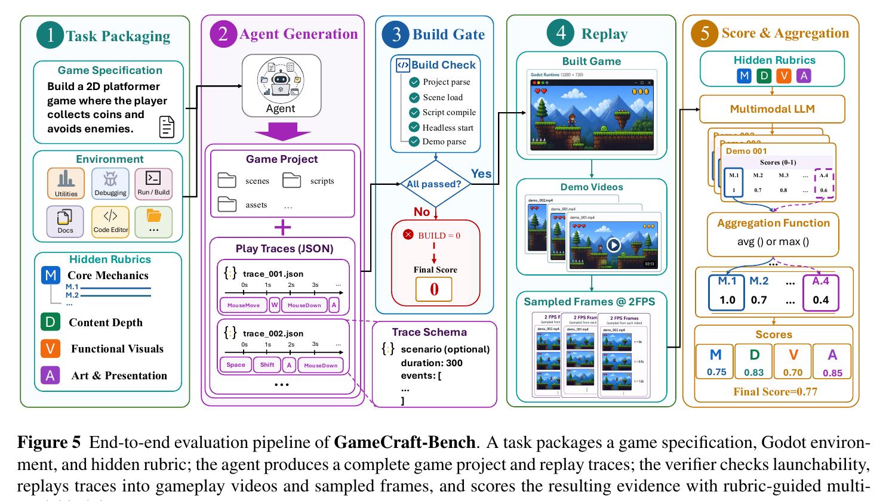
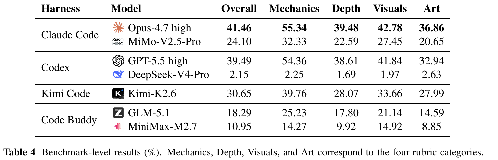

# 完整游戏交付与交互证据

## 1. Motivation：能启动，为什么还不等于可玩？

一个项目有角色、地图和按钮，甚至能正常启动，也可能缺少目标、挑战、进度或有效反馈。玩家输入之后，系统是否回应、规则是否成立、内容是否足够组成游戏循环，才是完整游戏生成需要回答的问题。

局部编辑基准能验证某一功能，静态截图能展示外观，但都不能单独证明 Agent 已把自然语言需求落实为完整游戏。GameCraft-Bench 将评测单位推进到可启动、可交互的 Godot 项目。（§1–2）

## 2. Insight：同时约束环境、交付物和验证方式

作者提出三项要求：Engine Grounding、Artifact Completeness、Interactive Verification。它们分别约束在哪里开发、交付什么，以及怎样检查结果。

一个完整提交包含游戏项目 G 和操作演示 Π。项目是被评测的系统，演示则说明评测器应怎样操作它。通过重放演示，评测器不必为每个陌生游戏重新学习控制或寻找玩法。（§3.1–3.2）

**阅读理解：** 这是一种把开放式游戏生成转成可重复收集交互证据的办法，但它没有把所有质量判断转成确定性状态断言；回放之后仍主要依靠多模态 judge。

## 3. Method：从需求到演示，再到 rubric

**读图要点：** 左侧给 Agent 的需求与环境、评测方保留的隐藏 rubric 是两部分。右侧先确认项目和演示可执行，再从实际操作得到画面证据；“可启动”只是门控，不是最终质量分。

140 个任务覆盖 15 个游戏家族。12 名具有丰富游戏经验的标注者编写公开的产品式需求和隐藏 rubric，再用最小可玩的 oracle 检查需求、演示和评分条目是否一致。rubric 应与需求对应，不应增加未要求的主观偏好。（§3.4）

评测包含四个关键环节：

- **Build Gate：** 项目启动失败，或没有可解析的演示时，最终分为零。
- **Replay：** 每段有效演示从新的 Godot 实例启动，在 1280×720 视口内执行鼠标和键盘事件。
- **Judge：** 录制视频，以 2 FPS 抽帧，用隐藏 rubric 对每段证据评分。
- **Aggregation：** 场景特定条目取最大值，持续性要求取均值，再聚合类别分数。

| 类别 | 权重 | 关注的内容 |
| --- | --- | --- |
| Core Mechanics | 15% | 规则、状态变化、核心交互 |
| Content Depth | 35% | 内容变化、进度和后期状态 |
| Functional Visuals | 15% | 可读性、目标提示和反馈 |
| Art and Presentation | 35% | 美术、整体一致性和呈现 |

这些权重体现作者对完整游戏质量的定义，不是游戏开发能力普遍重要性的定律。（§3.2）

## 4. Experiments：可运行率高，完整质量仍低

**读表要点：** 分数是 0–100 的质量指标，不是任务全部通过的比例。Mechanics、Depth、Visuals 和 Art 分别对应上表四类 rubric。

| 配置 | 总体 | 核心机制 | 内容深度 | 功能视觉 | 美术呈现 |
| --- | --- | --- | --- | --- | --- |
| Opus-4.7 high / Claude Code | 41.46 | 55.34 | 39.48 | 42.78 | 36.86 |
| GPT-5.5 high / Codex | 39.49 | 54.36 | 38.61 | 41.84 | 32.94 |
| Kimi-K2.6 / Kimi Code | 30.65 | 39.76 | 28.07 | 33.66 | 27.99 |

最强配置整体为 41.46。与此同时，Opus 的项目启动通过率为 97.9%，有效演示率为 96.4%。这说明“能启动、有演示”与“满足完整游戏质量要求”之间仍有很大差距。（图 6；表 4）

作者观察到 Agent 更容易做出可识别的局部机制，却难以补足内容、视觉反馈和呈现。工具调用次数也不等于质量：MiMo 的总调用数与得分相关系数约为 +0.016，部分项目虽能启动，却没有提交演示，从而得零分。（§5.1）

## 5. Judge 的可靠性：稳定不等于完全准确

在 Simulation 和 Card Game 两类的固定交互证据上，作者将 GPT-5.5 judge 重复运行 10 次，报告较小的分数标准差。例如 Opus 配置对应的标准差为 0.0050 和 0.0036，使用 0–1 分数尺度。（§5.2，图 9）

人工校准只覆盖 Kimi 提交的三个家族。总体人工分为 22.69，judge 为 26.02，差值为 +3.32 个百分点；内容与美术方面 judge 较宽松，功能视觉方面较严格。（表 5）

这些结果支持该子集上的重复评分稳定性和初步校准，不能解释成全任务范围的高人工一致性。论文明确将小样本比较定位为校准检查，而非完整的人类一致性研究。

## 6. 结论边界与启发

**作者的主张：** 完整游戏评估必须覆盖引擎、交付与交互，不能停留于编译通过或静态外观。**阅读判断：** 最重要的启发是让 Agent 闭合“构建—操作—观察—交付证据”的流程，而不只是持续写代码或运行命令。

回放机制固定了操作证据，但画面抽样与 Agent 自编演示也带来范围问题：未展示的路径可能缺少证据，快速状态变化可能难以看清。当前结果没有证明所有隐藏逻辑都已验证。

与 GameDevBench 相比，这里要求完整构建；与 SWE-Game 相比，主要质量判分更依赖多模态 rubric。三者测量的任务与证据不同，不宜用排行榜数字直接比较。

## 7. 值得继续追问

- 如何检查没有在演示中出现的需求和失败路径？
- 更高抽帧频率、交互探索或引擎状态探针能否补充视觉盲区？
- 改变内容与美术权重后，Agent 排名是否稳定？
- 在更多家族上，judge 与人工评分的一致性如何？

## References

[原文：GameCraft-Bench，arXiv:2606.17861v1](https://arxiv.org/abs/2606.17861v1)，2026-06-16。本文依据正文第 1–15 页；图表来自原始 PDF，未改动数值，公开实现尚未核查。

[对照阅读：GameDevBench](https://tiankanghui.github.io/PaperReading/papers/gamedevbench.html) · [对照阅读：SWE-Game](https://tiankanghui.github.io/PaperReading/papers/swe-game.html)
