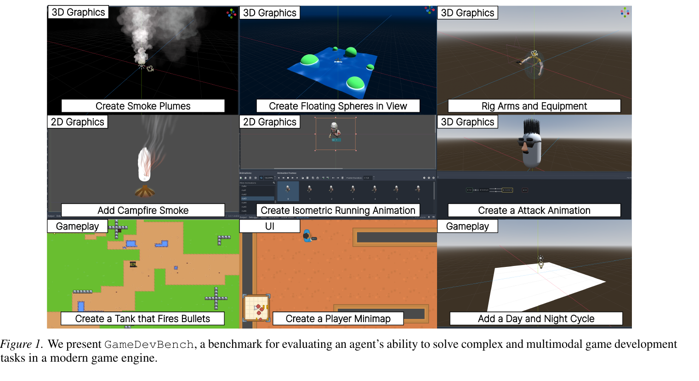
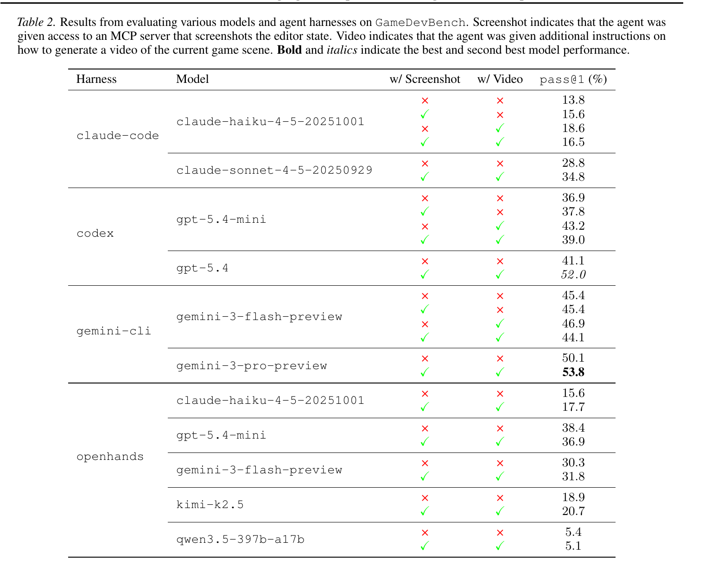

# 多模态游戏开发的任务、反馈与验证

## 1. Motivation：游戏开发为什么不同于普通代码任务？

给角色添加行走动画，看起来只是一个小功能，实际上需要从精灵图中选对动作帧、建立动画资源、连接场景节点，再让运动逻辑在正确时刻触发动画。代码能够运行，不代表素材和玩家看到的行为正确。

传统软件基准主要围绕代码与测试。游戏开发把代码、图片、动画、材质、碰撞和场景层级连在一起，为研究多模态 Agent 提供了更有结构的环境。GameDevBench 的问题是：Agent 能否在真实 Godot 项目中完成这些具体开发需求？（§1）

**读图要点：** 这些任务不是换一个提示生成同类游戏，而是分别要求创建烟雾、浮动球体、角色动画、投射物或昼夜周期。每个任务涉及的素材、状态和集成方式不同。

## 2. Insight：多模态解题，可以配合确定性判分

作者把“如何找到解”和“如何验证解”分开。Agent 需要看懂图像和场景，但 judge 可以利用引擎结构与运行状态检查动画、相机可见性和碰撞。多模态任务不必全部变成 VLM 看图打分。（§3.2）

另一个关键是任务的粒度：局部开发任务可以明确指定目标并提供可验证的参考解，同时保留跨文件修改的复杂性。它适合分析具体技能，但不能直接替代完整游戏交付的评估。

**阅读理解：** 这个设计把视觉理解的难点留在开发过程中，把最终判分尽量放到可重复执行的行为检查上。

## 3. Method：教程如何变成评测任务？

作者收集具有开放许可参考仓库的 Godot 4 网页与视频教程，将教程材料转换成任务指令、起始项目、测试和参考解。自动任务构造后，经过自动修订及人工审核，最终保留 154 个任务和 179 个变体，共 333 个。

8 名人工标注者参与审核，其中 5 名有游戏开发经验。审核关注指令是否明确、任务是否可解、测试是否要求了指令之外的内容，以及是否过度限制合法实现。（§2）

| 技能类别 | 任务占比 | 典型内容 |
| --- | --- | --- |
| 2D 图形与动画 | 33.3% | 精灵动画、TileMap、2D shader |
| 3D 图形与动画 | 26.7% | 材质、骨骼动画、相机 |
| 用户界面 | 20.1% | HUD、菜单导航、主题 |
| 玩法逻辑 | 19.8% | 控制器、碰撞、状态与信号 |

Agent 获得项目、代码、素材和任务指令，修改后由 Godot 内的测试判定。参考解平均修改 4.7 个文件、114.1 行代码，涉及 3.2 种文件类型。任务虽局部，仍需要场景、资源和脚本共同工作。（§3，表 1）

## 4. Feedback：截图和视频提供给开发中的 Agent

论文比较两种附加反馈。编辑器截图 MCP 返回场景、节点树和属性面板；运行视频展示真实相机视图及随时间变化的效果。它们帮助 Agent 自检，不替代最终的确定性测试。（§4.1）

这一区分很重要：开发过程中看图，并不意味着评分器也在用图像模型决定任务是否通过。

## 5. Experiments：视觉反馈有帮助，但不是所有配置都受益

**读表要点：** Screenshot 和 Video 表示 Agent 获得的工具或操作指引；最后一列是测试通过率。模型、框架和反馈配置必须一起读，不能只看模型名。

| 配置 | 无额外反馈 | 截图＋视频 | 差值 |
| --- | --- | --- | --- |
| GPT-5.4 / Codex | 41.1% | 52.0% | +10.9 个百分点 |
| Claude Sonnet 4.5 / Claude Code | 28.8% | 34.8% | +6.0 个百分点 |
| Gemini 3 Pro / Gemini CLI | 50.1% | 53.8% | +3.7 个百分点 |
| Gemini 3 Flash / Gemini CLI | 45.4% | 44.1% | −1.3 个百分点 |

最高配置为 Gemini 3 Pro 配合截图与视频，pass@1 为 53.8%。原生框架、启用两类反馈的 8 个配置中，玩法逻辑平均通过率为 51.4%，3D 图形为 38.4%，2D 图形与动画为 33.0%，UI 为 32.0%。（§4.2）

错误分析指出两类常见问题：选错图像或精灵帧，以及不熟悉引擎中的节点层级、信号和资源绑定。它们说明“写出一段正确脚本”和“完成真实游戏功能”之间还有集成与感知的距离。（§4.3）

## 6. 结论边界与相关工作

截图和视频在多个配置上改善结果，但不能推成“更多视觉工具一定更好”。反馈也可能增加成本；模型与框架之间存在工具适配差异，类别难度差异也没有独立隔离某一种认知能力。

| 基准 | 评测单位 | 主要判分证据 |
| --- | --- | --- |
| GameDevBench | 已有项目中的具体开发任务 | Godot 状态与行为测试 |
| GameCraft-Bench | 从需求出发的完整游戏 | 回放画面与多模态 rubric |
| SWE-Game | 构建、补全、修复、迁移 | 运行时检查、回放及视觉评分 |

这是阅读三篇论文形成的比较。GameDevBench 的任务通过率和 GameCraft-Bench 的质量分口径不同，不能用 53.8 与 41.46 直接比较开发能力。

## 7. 值得继续追问

- 测试怎样容许不同但同样正确的节点与动画实现？
- 教程与任务变体如何影响多样性及数据污染风险？
- 视觉反馈收益有多少来自更好的感知，多少来自更多迭代和预算？
- 局部任务表现能否预测完整游戏交付能力？

## References

[原文：GameDevBench，arXiv:2602.11103v2](https://arxiv.org/abs/2602.11103v2)，2026-06-30，PDF 标注 ICML 2026。本文依据正文第 1–9 页；图表来自原始 PDF，未改动数值，公开测试实现尚未核查。

[对照阅读：GameCraft-Bench](https://tiankanghui.github.io/PaperReading/papers/gamecraft-bench.html) · [对照阅读：SWE-Game](https://tiankanghui.github.io/PaperReading/papers/swe-game.html)
